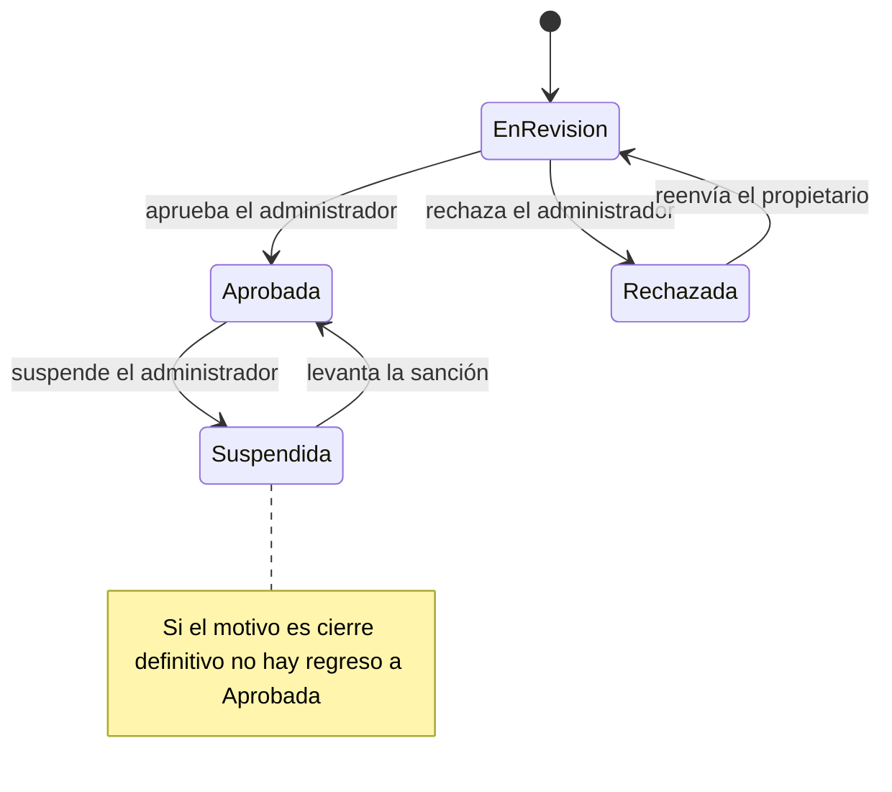
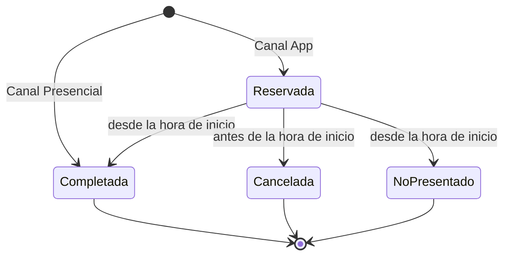

# Reglas de negocio — BarberiaSaasApi

Nov 19, 2026

Este documento fija qué puede y qué no puede pasar en el sistema, con el vocabulario del glosario. Cada regla indica su origen (la decisión D-xx), dónde se garantiza (código, SQL Server o ambos) y al menos un caso que debe aceptarse y otro que debe rechazarse. Las reglas marcadas como PROPUESTA no están aprobadas todavía.

## 1. Barbería: estados y transiciones

Una barbería tiene cuatro estados y cinco transiciones permitidas; cualquier otro cambio de estado se rechaza.

### Transiciones permitidas

| De | A | Quién la ejecuta | Condición |
| --- | --- | --- | --- |
| EnRevision | Aprobada | Administrador | Supera la revisión previa (D-17) |
| EnRevision | Rechazada | Administrador | No supera la revisión previa (D-17) |
| Rechazada | EnRevision | Propietario | Corrige las observaciones y reenvía la solicitud (D-17) |
| Aprobada | Suspendida | Administrador | Por sanción inmediata (D-21) o por cierre definitivo solicitado por el propietario (D-20, D-31) |
| Suspendida | Aprobada | Administrador | Solo si el motivo de suspensión es sanción; con motivo de cierre definitivo está prohibida (Q-17) |

### Transiciones prohibidas

| De | A | Por qué |
| --- | --- | --- |
| EnRevision | Suspendida | Un local que aún no ha sido aprobado ni ha operado no puede ser sancionado ni cerrado; si incumple requisitos, se rechaza |
| Rechazada | Aprobada | El propietario debe corregir y reenviar la solicitud a revisión antes de poder ser aprobada |
| Rechazada | Suspendida | Una barbería rechazada no está operativa ni visible al público, por lo que no procede suspenderla |
| Aprobada | EnRevision | Una vez aprobada no vuelve a la cola de evaluación inicial; cualquier irregularidad posterior se gestiona mediante suspensión |
| Aprobada | Rechazada | El rechazo aplica solo al alta inicial; un local ya aprobado se suspende, no se rechaza |
| Suspendida | EnRevision | Una suspensión por sanción se levanta volviendo a Aprobada, y un cierre definitivo no se reabre; para volver a operar se registra una solicitud nueva |
| Suspendida | Rechazada | El rechazo solo ocurre en el alta inicial; una barbería suspendida solo puede permanecer así o, si fue por sanción, volver a Aprobada |

### Reglas

| ID | Regla | Origen | Se garantiza en | Casos de prueba |
| --- | --- | --- | --- | --- |
| RN-001 | Una barbería solo es visible al público y acepta reservas cuando su estado es Aprobada | D-17 | Código: las consultas públicas filtran por estado y la creación de citas lo valida | Se acepta: una barbería Aprobada aparece y acepta una reserva. Se rechaza: una barbería EnRevision, Rechazada o Suspendida no aparece y rechaza la reserva |
| RN-002 | Toda barbería se crea en estado EnRevision | D-17 y glosario (Q-06 pendiente) | Código (la creación fija el estado) y SQL Server (valor predeterminado y restricción CHECK de los cuatro valores) | Se acepta: crear una barbería la deja EnRevision. Se rechaza: guardar un estado que no sea uno de los cuatro |
| RN-003 | El estado de una barbería solo cambia mediante las cinco transiciones permitidas; cualquier otra se rechaza | D-17, D-20, D-21, D-31, D-33 y D-34 | Código: un único componente valida cada cambio de estado. SQL Server solo limita los valores posibles, no las transiciones | Se acepta: cada una de las cinco transiciones permitidas. Se rechaza: cada una de las siete prohibidas |
| RN-004 | EnRevision a Aprobada, EnRevision a Rechazada, Aprobada a Suspendida y Suspendida a Aprobada solo las ejecuta el Administrador de la plataforma | D-17, D-20, D-21 | Código (autorización) | Se acepta: el administrador aprueba una barbería. Se rechaza: el propietario intenta aprobar su propia barbería |
| RN-005 | Solo el Propietario de la barbería puede reenviarla a revisión (Rechazada a EnRevision) | D-17 | Código (autorización y aislamiento entre barberías) | Se acepta: el propietario reenvía su barbería Rechazada. Se rechaza: otro propietario intenta reenviarla |
| RN-006 | La suspensión por sanción es inmediata, no depende del propietario y conserva las citas existentes sin cancelarlas | D-21, D-19 | Código | Se acepta: el administrador suspende una barbería con citas Reservada y estas siguen Reservada. Se rechaza: cancelar citas de forma automática al suspender (no existe el origen Sistema) |
| RN-007 | El cierre definitivo lo solicita el Propietario y lo ejecuta el Administrador, y exige que todos los barberos estén desactivados; por D-18, eso implica que no quedan citas futuras Reservada | D-18, D-20 | Código | Se acepta: cierre con todos los barberos desactivados. Se rechaza: cierre con algún barbero activo |
| RN-008 | Al entrar en Suspendida, la barbería recibe un motivo de suspensión (sanción o cierre definitivo) | D-31 | Código (obligatorio al suspender) y SQL Server (CHECK: el motivo es obligatorio cuando el estado es Suspendida) | Se acepta: Suspendida con motivo. Se rechaza: Suspendida sin motivo |
| RN-009 | Una barbería Suspendida con motivo de cierre definitivo no puede volver a Aprobada; para operar de nuevo, el propietario registra una solicitud nueva desde cero, que nace EnRevision | D-33 (Q-17, resuelta el 19 de noviembre de 2026) | Código. SQL Server no puede, porque necesitaría conocer el estado anterior | Se acepta: una Suspendida por sanción vuelve a Aprobada. Se rechaza: una Suspendida por cierre pasa a Aprobada |
| RN-010 | La solicitud nueva tras un cierre definitivo es un registro de Barbería nuevo; el registro cerrado conserva su historial intacto y no se reutiliza | Q-17 | Código | Se acepta: el propietario registra una barbería nueva con su propio catálogo y barberos. Se rechaza: reutilizar el registro cerrado |
| RN-011 | El motivo de suspensión no puede modificarse mientras la barbería sigue Suspendida | Consecuencia de Q-17: sin esta regla, cambiar el motivo permitiría reabrir un cierre | Código | Se rechaza: cambiar el motivo de cierre a sanción para poder volver a aprobar la barbería |

## 2. Cita: estados y transiciones

Una cita tiene cuatro estados y tres transiciones permitidas, todas desde Reservada; Completada, Cancelada y NoPresentado son estados finales.

### Cómo nace una cita

| Canal | Estado inicial | Origen |
| --- | --- | --- |
| App | Reservada | D-09 |
| Presencial | Completada | D-28 |

### Transiciones permitidas

| De | A | Quién la ejecuta | Condición temporal |
| --- | --- | --- | --- |
| Reservada | Completada | Personal de la barbería (detalle en Q-07) | Desde la hora de inicio de la cita |
| Reservada | NoPresentado | Personal de la barbería (detalle en Q-07) | Desde la hora de inicio de la cita |
| Reservada | Cancelada | Cliente con su código de gestión, o la Barbería (D-10) | En cualquier momento antes de la hora de inicio; sin plazo anticipado en el MVP (Q-10) |

### Transiciones prohibidas

| De | A | Por qué |
| --- | --- | --- |
| Completada | Reservada | Una cita ya atendida no vuelve a estado pendiente de atención |
| Completada | Cancelada | Una cita ya completada no se cancela; cualquier ajuste posterior se trata aparte |
| Completada | NoPresentado | Si ya se completó la atención, el cliente sí asistió |
| Cancelada | Reservada | Una cita cancelada libera el hueco y no se reactiva como reserva vigente |
| Cancelada | Completada | No se puede marcar como completada una cita que fue cancelada |
| Cancelada | NoPresentado | Una cita cancelada no entra en el flujo de inasistencia |
| NoPresentado | Reservada | Un turno ya cerrado por inasistencia no vuelve a estado Reservada |
| NoPresentado | Completada | No se permite el cambio directo entre estados finales sin una regla explícita de corrección |
| NoPresentado | Cancelada | Una cita marcada como inasistencia no pasa a cancelada |

### Reglas

| ID | Regla | Origen | Se garantiza en | Casos de prueba |
| --- | --- | --- | --- | --- |
| RN-012 | Una cita creada por la app nace Reservada, y una atención presencial nace Completada; el solicitante no puede fijar el estado inicial | D-09, D-28 | Código (la creación fija el estado según el canal) y SQL Server (CHECK de los cuatro valores permitidos) | Se acepta: una cita App queda Reservada y una presencial queda Completada. Se rechaza: una solicitud que intenta crear una cita App ya Completada |
| RN-013 | El estado de una cita solo cambia mediante las tres transiciones permitidas; cualquier otra, incluida salir de un estado final, se rechaza | D-09, D-10, D-11 y D-35 | Código: un único componente valida cada cambio de estado. SQL Server solo limita los valores posibles | Se acepta: cada una de las tres permitidas. Se rechaza: cada una de las nueve prohibidas |
| RN-014 | Completada y NoPresentado solo las marca el personal de la barbería, y solo a partir de la hora de inicio de la cita | D-11 | Código (autorización y validación de la hora) | Se acepta: marcar Completada a las 10:00 una cita de 10:00. Se rechaza: marcarla a las 09:59, o que un Cliente intente marcarla |
| RN-015 | Completada y NoPresentado no se marcan automáticamente por el paso del tiempo | D-11 | Código (no existe ningún proceso automático que cambie estados) | Se acepta: una cita Reservada cuya hora de fin ya pasó sigue Reservada. Se rechaza: cualquier cambio de estado sin una acción del personal |
| RN-016 | Una cita Reservada solo puede cancelarla el Cliente con su código de gestión o la Barbería, y solo antes de su hora de inicio; en el MVP no hay plazo anticipado | D-10, Q-10 | Código | Se acepta: cancelar a las 09:59 una cita de las 10:00. Se rechaza: cancelar a las 10:00, o cancelar una cita Completada |
| RN-017 | Al cancelar se registran la fecha y el origen (Cliente o Barbería); el origen lo fija el sistema según quién ejecuta la acción, nunca un dato enviado por el solicitante | D-10, D-19 | Código (el origen se deduce del código de gestión o de la cuenta autenticada) y SQL Server (CHECK: origen obligatorio cuando el estado es Cancelada, con solo esos dos valores) | Se acepta: una cancelación con código de gestión queda con origen Cliente. Se rechaza: una solicitud que envía el origen, o Cancelada sin origen |
| RN-018 | Solo las citas Reservada y Completada bloquean el hueco del barbero; Cancelada y NoPresentado lo liberan | D-27, D-29 | Código: la consulta de solapamientos filtra por esos estados | Se acepta: reservar en el hueco de una cita Cancelada. Se rechaza: reservar en el hueco de una cita Reservada |
| RN-019 | Una cita Reservada cuya hora de fin ya transcurrió sin marcarse es una cita pendiente de resolver: sigue bloqueando su hueco y no suma a ingresos ni a inasistencias | D-11 | Código: una consulta las lista | Se acepta: aparece en la lista de pendientes de resolver. Se rechaza: contarla como ingreso o como inasistencia |

Limitación conocida: los errores de marca en un estado final no se corrigen desde la aplicación en el MVP. El mecanismo de ajuste controlado es la pendiente Q-18.

## 3. Crear una cita

Crear una cita por la app exige nueve validaciones y tres reglas de creación, y todo se guarda en una sola transacción: si algo falla, no queda nada a medias. El orden de las validaciones importa para los mensajes de error, y la respuesta concreta de cada fallo se define en la Fase 5.

### Reglas

| ID | Regla | Origen | Se garantiza en | Casos de prueba |
| --- | --- | --- | --- | --- |
| RN-020 | La barbería de la cita existe y está Aprobada | D-17, RN-001 | Ambos: SQL Server garantiza que existe (clave foránea) y el código valida el estado | Se rechaza: reservar en una barbería EnRevision, Rechazada, Suspendida o inexistente |
| RN-021 | El nombre y el teléfono del Invitado son válidos | Glosario (Invitado), Q-19 | Ambos: SQL Server exige campos obligatorios y longitudes; el código valida el formato y la normalización del teléfono (Q-19) | Se rechaza: crear una cita sin nombre, o con un teléfono vacío o inválido |
| RN-022 | El barbero pertenece a la barbería de la cita | D-26 | Ambos: SQL Server con una clave foránea compuesta (BarberiaId, BarberoId), y el código lo valida antes para devolver un error claro | Se rechaza: enviar un BarberoId que pertenece a otra barbería |
| RN-023 | El servicio pertenece a la barbería de la cita | D-26 | Ambos: SQL Server con una clave foránea compuesta (BarberiaId, ServicioId), y el código lo valida antes para devolver un error claro | Se rechaza: enviar un ServicioId que pertenece a otra barbería |
| RN-024 | El barbero y el servicio están activos | D-25 | Solo código: SQL Server guarda el indicador, pero no puede comprobarlo al reservar | Se rechaza: reservar con un barbero desactivado o con un servicio inactivo |
| RN-025 | El barbero está autorizado para ese servicio, con la relación barbero–servicio activa | Glosario (Servicio autorizado para un barbero), D-26 | Solo código: la cita no referencia la relación barbero–servicio, así que SQL Server no valida esta relación; por eso sus pruebas son especialmente importantes | Se rechaza: reservar un servicio que el barbero seleccionado no tiene habilitado |
| RN-026 | La cita no está en el pasado | Q-01 (pendiente) | Código; depende de la zona horaria, pendiente en Q-01 | Se rechaza: una hora de inicio anterior a la hora actual |
| RN-027 | La hora de inicio cae dentro de un tramo del horario de trabajo del barbero, y el servicio cabe entero en él | D-14 | Código | Se rechaza: pedir las 17:45 si el barbero cierra a las 18:00 y el servicio dura 45 minutos |
| RN-028 | La cita no se solapa con otra que bloquee el hueco, incluidas las solicitudes simultáneas | D-27, D-29, Q-05 | Código con una transacción con bloqueo apoyada en SQL Server (técnica pendiente en Q-05); SQL Server no tiene una restricción nativa de solapamiento de intervalos ni evita por sí solo las condiciones de carrera | Se rechaza: reservar de 10:15 a 10:45 cuando existe una cita de 10:00 a 10:30. Si dos reservas simultáneas piden el mismo hueco, solo una tiene éxito |
| RN-029 | Crear una cita ejecuta, en una sola transacción, la búsqueda o creación del Cliente por barbería y teléfono, el cálculo de los datos que fija el sistema, la generación del código de gestión único y el guardado de la cita | D-06, D-07, D-15 | Código (transacción) | Se acepta: una reserva válida crea el Cliente si no existía, la cita y el código. Se rechaza: un fallo al generar el código no deja creados ni el Cliente nuevo ni la cita |
| RN-030 | El sistema fija el estado inicial, el canal, el origen, el precio, la duración y la hora de fin; una solicitud que envíe alguno de esos valores se rechaza | D-09, D-15, RN-012 | Código | Se rechaza: enviar un precio distinto del catálogo, o un estado Completada |
| RN-031 | El precio aplicado y la duración de la cita se copian del servicio al confirmar y no cambian cuando se edita el catálogo | D-15 | Código al crear; SQL Server guarda los valores en columnas propias de la cita | Se rechaza: que una edición posterior del precio o de la duración del servicio altere una cita ya reservada |

Pendiente derivada: Q-19, el formato válido del teléfono y su normalización, necesario para que la unicidad del Cliente por barbería y teléfono (D-06) funcione. Se resuelve en la Fase 2.

## 4. Cliente y código de gestión

El Cliente se reutiliza por barbería y teléfono, y el código de gestión es la única llave del Invitado para consultar o cancelar su cita, con reglas que limitan lo que ese acceso permite.

### Reglas

| ID | Regla | Origen | Se garantiza en | Casos de prueba |
| --- | --- | --- | --- | --- |
| RN-032 | Si ya existe un Cliente con ese teléfono (normalizado según Q-19) en esa barbería, se reutiliza; si no existe, se crea uno nuevo | D-06, Q-19 | Ambos: el código busca o crea el registro, y SQL Server impone la unicidad por barbería y teléfono con una restricción UNIQUE | Se rechaza: guardar un segundo Cliente con el mismo teléfono en la misma barbería |
| RN-033 | El código de gestión tiene 8 caracteres generados con aleatoriedad criptográfica, y es único | D-07 | Ambos: SQL Server garantiza la unicidad con un índice único filtrado sobre los códigos no vacíos (las atenciones presenciales no tienen código, RN-052), y el código genera otro si hay colisión | Se acepta: ante una colisión, el código genera uno nuevo. Se rechaza: guardar un segundo código igual, que el índice impide |
| RN-034 | Para consultar o cancelar una cita se exigen dos datos, el código de gestión y el teléfono del Cliente; si fallan, la respuesta es un error genérico que no revela si el código existe | D-07 | Código | Se acepta: código y teléfono correctos. Se rechaza: enviar solo el código, o un teléfono que no corresponde a esa cita |
| RN-035 | El acceso por código tiene un límite de intentos | D-07 | Código (limitador de solicitudes en ese endpoint); el valor del límite se fija en la Fase 7 | Se rechaza: seguir probando códigos tras superar el límite |
| RN-036 | El código permite consultar una cita en cualquier estado hasta su hora de fin; después de la hora de fin deja de funcionar para consultar y cancelar. Cancelar sigue sujeto a RN-016 | D-07, D-36 (Q-21, resuelta el 20 de noviembre de 2026) | Código | Se acepta: consultar con el código una cita Cancelada antes de su hora de fin. Se rechaza: consultar o cancelar con el código después de la hora de fin |
| RN-037 | La consulta devuelve solo la cita del código; nunca otras citas del mismo teléfono ni datos de otros Clientes | D-07, S-01 | Código | Se rechaza: una consulta que devuelva las demás citas del mismo Cliente o datos de otro Cliente |
| RN-038 | Al comparar un teléfono se usa el mismo formato normalizado con el que se guardó | Q-19 | Código; SQL Server guarda ya el valor normalizado | Se acepta: dos escrituras distintas del mismo teléfono encuentran el mismo Cliente (el formato exacto lo fija Q-19). Se rechaza: tratarlas como Clientes distintos |
| RN-039 | En una atención presencial, si el barbero obtiene el teléfono se aplica RN-032; si no, no se crea Cliente | D-13 | Código; SQL Server admite ClienteId vacío solo cuando el Canal es Presencial | Se acepta: una atención presencial sin teléfono queda sin Cliente. Se rechaza: una cita de Canal App sin Cliente |

Pendiente derivada: Q-20, qué ocurre con el nombre cuando llega el mismo teléfono con otro nombre en esa barbería (si se actualiza o se conserva el anterior). Se resuelve al diseñar la tabla Cliente en la Fase 2.

## 5. Agenda y disponibilidad

El horario de cada barbero se guarda como tramos semanales, y la disponibilidad no se guarda: se calcula cada vez a partir de los tramos y de las citas que bloquean el hueco.

### Reglas

| ID | Regla | Origen | Se garantiza en | Casos de prueba |
| --- | --- | --- | --- | --- |
| RN-040 | Un tramo del horario es válido cuando su hora de inicio es anterior a su hora de fin y no se solapa con otro tramo del mismo barbero en el mismo día | D-14 | Ambos: SQL Server valida con un CHECK que el inicio sea anterior al fin; el código valida que los tramos del mismo día no se solapen, porque SQL Server no tiene una restricción nativa de solapamiento | Se rechaza: un tramo de 14:00 a 12:00, o dos tramos solapados de 09:00–12:00 y 11:00–13:00 |
| RN-041 | Un barbero sin tramos de horario no tiene disponibilidad ni recibe reservas por la app | D-14, glosario (Disponibilidad) | Código | Se rechaza: pedir disponibilidad o agendar una cita por la app para un barbero sin tramos |
| RN-042 | La disponibilidad se calcula a partir de los tramos del horario menos las citas que bloquean el hueco (RN-018); no se guardan huecos libres | D-14, D-29, RN-018 | Código | Se rechaza: guardar una lista de huecos libres que pueda quedar desactualizada |
| RN-043 | Un hueco libre solo sirve para reservar si cabe entero el servicio, con la duración de catálogo vigente en ese momento, que se congela en la cita al confirmarla | D-15, glosario (Hueco) | Código | Se rechaza: reservar un servicio de 45 minutos cuando solo queda un hueco libre de 30 minutos |
| RN-044 | Se permiten citas contiguas, siempre que no haya solapamiento | Glosario (Solapamiento) | Código | Se acepta: una cita de 10:30 a 11:00 cuando otra termina a las 10:30 |
| RN-045 | El horario de un barbero lo puede modificar el propio barbero, si tiene cuenta, y el Propietario de su barbería; el de un barbero sin cuenta solo lo modifica el Propietario. La barbería no tiene un horario marco | D-14, D-23, D-37 (Q-22, resuelta el 21 de noviembre de 2026) | Código (autorización y aislamiento entre barberías) | Se acepta: un barbero con cuenta edita su horario, y el Propietario edita el de cualquiera de sus barberos. Se rechaza: un barbero edita el horario de otro barbero, o un Propietario edita el horario de un barbero de otra barbería |
| RN-046 | Un cambio de horario (recortar, mover o borrar un tramo) se rechaza mientras exista alguna cita Reservada futura que quede fuera del nuevo horario; quien lo hace debe cancelarlas antes, con origen Barbería | D-18, D-20, RN-027, D-38 (Q-23, resuelta el 21 de noviembre de 2026) | Código | Se acepta: recortar el horario cuando todas las citas Reservada futuras siguen dentro de él. Se rechaza: recortar de 18:00 a 16:00 cuando hay una cita Reservada a las 17:00, o borrar el tramo de un día que tiene citas Reservada futuras |

Pendientes derivadas: Q-08 (granularidad de huecos, antelación mínima y máxima, descansos y feriados), Q-09 (bloqueos de agenda).

## 6. Registrar una atención presencial

Una atención presencial es una Cita con canal Presencial que comparte casi todas las validaciones de crear una cita; las reglas de esta sección recogen dónde se diferencia. El Cliente en una atención presencial se rige por RN-039.

### Reglas

| ID | Regla | Origen | Se garantiza en | Casos de prueba |
| --- | --- | --- | --- | --- |
| RN-047 | Una atención presencial pasa las mismas validaciones de la sección 3 sobre barbería, barbero, servicio y solapamiento: RN-020, RN-022, RN-023, RN-024, RN-025 y RN-028 | D-12, D-27 | Igual que en esas reglas | Se rechaza: registrar en una barbería EnRevision, con un barbero no autorizado para el servicio, o solapada con otra cita del mismo barbero. Se acepta: registrar una atención en el hueco de una cita Reservada pendiente de resolver una vez marcada esta como NoPresentado (RN-019, RN-014) |
| RN-048 | Pueden registrar una atención presencial el barbero con cuenta para sí mismo y el Propietario para cualquier barbero de su barbería, y es el único que puede hacerlo para barberos sin cuenta; el detalle fino queda en Q-07 | RN-045, Q-07 | Código (autorización por rol y pertenencia) | Se rechaza: un barbero con cuenta registrando una atención a nombre de otro barbero |
| RN-049 | La hora de inicio de una atención presencial no puede estar en el futuro; hasta cuánto hacia atrás puede registrarse está pendiente (Q-24) | D-28, Q-24 | Código | Se rechaza: registrar una atención con hora de inicio de mañana o posterior al momento actual |
| RN-050 | Una atención presencial no tiene que caer dentro del horario de trabajo del barbero, pero sigue sin poder solaparse con otras citas | D-27, D-39 (resuelta el 21 de noviembre de 2026) | Código (RN-027 no se aplica en presencial) | Se acepta: una atención real ocurrida después de la hora de cierre del barbero, si no se solapa. Se rechaza: esa misma atención si se solapa con otra cita |
| RN-051 | El sistema fija el estado Completada, el canal Presencial, el precio aplicado y la duración del catálogo vigente, y calcula la hora de fin; quien registra fija solo el importe cobrado, que es obligatorio y no negativo | D-12, D-15, D-16, D-28 | Código y SQL Server (CHECK: el importe cobrado es obligatorio y no negativo cuando el estado es Completada) | Se rechaza: una solicitud que envía el precio aplicado, la duración o el estado Reservada; un importe cobrado ausente o negativo |
| RN-052 | Una atención presencial no tiene código de gestión | D-07 | Ambos: el código no lo genera; SQL Server permite el código vacío solo cuando el canal es Presencial y lo exige cuando es App (CHECK) | Se rechaza: generar un código de gestión en una presencial, o una cita App sin código. Se acepta: dos atenciones presenciales sin código, que el índice filtrado de RN-033 no trata como duplicadas |
| RN-053 | Registrar una atención presencial se guarda en una sola transacción, junto con la búsqueda o creación del Cliente si se informó teléfono | D-13, RN-039 | Código (transacción) | Se rechaza: dejar creado un Cliente nuevo cuando falla el guardado de la atención |

Pendientes derivadas: Q-24 (hasta cuánto hacia atrás puede registrarse una atención presencial) y Q-07 (permisos finos).

## 7. Dinero e ingresos

El ingreso sale de lo realmente cobrado en las citas Completada, no de lo que se acordó al reservar. El precio aplicado se rige por RN-031 y RN-051.

### Reglas

| ID | Regla | Origen | Se garantiza en | Casos de prueba |
| --- | --- | --- | --- | --- |
| RN-054 | Al marcar una cita Completada, el importe cobrado es obligatorio y no puede ser negativo; el importe cero está permitido (cortesía). En una atención presencial lo informa quien la registra | D-16, RN-014, RN-051, D-40 (resuelta el 21 de noviembre de 2026) | Ambos: el código exige el dato en la transición a Completada, y SQL Server impone un CHECK de que no esté vacío y no sea negativo cuando el estado es Completada | Se acepta: marcar Completada con importe 0. Se rechaza: marcar Completada sin importe, o con un importe negativo |
| RN-055 | El importe cobrado puede ser menor, igual o mayor que el precio aplicado, y ambos valores se conservan; guardar el importe cobrado nunca modifica el precio aplicado | D-16 | Código | Se acepta: un importe de 400 con un precio aplicado de 500, o uno de 600 con un precio aplicado de 500. Se rechaza: una operación que, al guardar el importe cobrado, cambie el precio aplicado |
| RN-056 | Solo las citas en estado Completada generan ingreso; las Reservada, Cancelada y NoPresentado no suman | D-16 | Código (consulta de ingresos) | Se acepta: una cita Completada con importe 0 cuenta como servicio realizado y suma 0. Se rechaza: sumar al ingreso una cita Reservada, Cancelada o NoPresentado |
| RN-057 | El ingreso de una cita se atribuye a la fecha del servicio (la de su hora de inicio), no a la del momento en que se marcó Completada; qué día es depende de la zona horaria (Q-01) | D-30, Q-01 | Código (consulta de ingresos) | Se acepta: una cita de las 23:00 marcada Completada al día siguiente cuenta en el día de la cita. Se rechaza: atribuirla al día en que se marcó |
| RN-058 | Los importes se guardan con tipo decimal exacto, nunca con coma flotante; la precisión y la escala se fijan en el diseño de la base de datos | D-16 | SQL Server (tipo de dato y CHECK) | Se rechaza: guardar un importe negativo |

Pendientes derivadas: Q-25 (moneda y reglas asociadas) y Q-15 (definición exacta de cada estadística).

## 8. Desactivaciones

Barberos, servicios y relaciones barbero–servicio no se borran: se desactivan, y las reglas distinguen entre desactivar a quien atiende, que exige resolver antes las citas futuras, y desactivar un servicio o una relación, que respeta las citas ya reservadas.

### Reglas

| ID | Regla | Origen | Se garantiza en | Casos de prueba |
| --- | --- | --- | --- | --- |
| RN-059 | No se puede desactivar a un barbero que tenga citas Reservada futuras; al desactivarse deja de aceptar citas nuevas y de ofrecer disponibilidad, y su horario y sus servicios autorizados se conservan | D-18, RN-024, RN-007 | Código: consulta de las citas Reservada futuras del barbero | Se rechaza: desactivar a un barbero con una cita Reservada mañana. Se acepta: desactivarlo cuando no le quedan citas Reservada futuras |
| RN-060 | Desactivar un servicio impide nuevas reservas de ese servicio, pero las citas Reservada futuras ya creadas siguen vigentes con su precio y duración congelados | D-41 (Q-02, resuelta el 22 de noviembre de 2026), RN-024, D-15 | Código | Se rechaza: crear una cita nueva con un servicio desactivado. Se acepta: marcar Completada una cita Reservada cuyo servicio se desactivó después de reservarla |
| RN-061 | Desactivar la relación entre un barbero y un servicio impide nuevas citas de ese servicio con ese barbero, y respeta las citas Reservada futuras ya existentes | Q-02, RN-024, RN-025, D-15 | Código | Se rechaza: agendar una cita nueva de un servicio con un barbero cuya relación con él está desactivada |
| RN-062 | Un barbero, un servicio o una relación desactivados pueden reactivarse; reactivar un barbero se rechaza si su cuenta ya está vinculada a otro barbero activo de la misma barbería | D-25, D-23 | Ambos: el código valida y restaura, y SQL Server lo impide con el índice único filtrado sobre (UsuarioId, BarberiaId) donde UsuarioId no es vacío y EstaActivo = 1 | Se rechaza: reactivar un barbero cuyo UsuarioId ya tiene otro barbero activo en la misma barbería. Se acepta: reactivar un barbero cuya cuenta tiene un barbero activo en otra barbería |
| RN-063 | Los barberos, los servicios y las relaciones barbero–servicio no se borran: se desactivan con un indicador y una fecha de baja, y SQL Server impide borrar físicamente una fila referenciada por citas | D-25 | SQL Server (columnas del indicador y de la fecha de baja, y claves foráneas) | Se rechaza: un DELETE de un servicio o de un barbero que tiene citas asociadas |

Pendientes derivadas: Q-26 (si las citas Reservada ya pasadas y pendientes de resolver también bloquean la desactivación de un barbero, porque D-18 solo habla de citas futuras) y Q-07 (quién puede desactivar y reactivar).

## 9. Aislamiento y autorización

Una barbería nunca ve ni toca los datos de otra, y los datos personales de los Clientes solo los ven quienes los necesitan dentro de su barbería. Estas reglas se diseñan en la Fase 2 y se implementan en la Fase 7.

### Reglas

| ID | Regla | Origen | Se garantiza en | Casos de prueba |
| --- | --- | --- | --- | --- |
| RN-064 | Nunca se confía en el BarberiaId ni en otros identificadores enviados por el cliente: se verifican contra las barberías sobre las que el usuario autenticado tiene permiso, como Propietario o como barbero vinculado a su cuenta | S-01, D-22, D-23 | Código: quién puede actuar sobre qué barbería lo decide solo el código; SQL Server solo garantiza la coherencia entre registros (D-26) | Se rechaza: un Propietario que solo administra la barbería 1 y envía una petición con BarberiaId = 2. Se acepta: un Propietario de las barberías 1 y 2 que envía BarberiaId = 2 |
| RN-065 | Toda decisión de autorización sobre una barbería pasa por un único componente que responde si el usuario autenticado puede actuar sobre ella y con qué rol | D-22, S-01 | Código | Se rechaza: una solicitud de un usuario sin permiso sobre la barbería, por cualquiera de los endpoints protegidos; cada endpoint protegido tiene una prueba que lo comprueba |
| RN-066 | Cada actor ve solo su ámbito: el Invitado, la cita de su código (RN-037); el barbero con cuenta, sus citas, su horario, sus servicios autorizados y sus ingresos (D-23, RN-045); el Propietario, los recursos de su barbería (D-24) | RN-037, D-23, D-24, RN-045 | Código (filtros obligatorios por contexto y rol) | Se rechaza: un barbero con cuenta que consulta el listado de citas de otro barbero de la misma barbería |
| RN-067 | Los datos personales de los Clientes (nombre y teléfono) solo los ven, dentro de su barbería, el Propietario y los barberos con cuenta en las citas que les corresponden; nunca en endpoints públicos ni el Administrador de la plataforma, que tampoco ve el detalle de las citas | D-06, D-24, D-42 (resuelta el 22 de noviembre de 2026) | Código (proyección de DTOs y control de acceso) | Se rechaza: el Administrador consulta el listado de Clientes o de citas de una barbería; un endpoint público que devuelve el teléfono de un Cliente |
| RN-068 | Los endpoints públicos solo exponen información de barberías Aprobada y nunca publican Clientes, teléfonos, ingresos ni citas internas | RN-001 | Código (filtro de estado y DTOs públicos) | Se rechaza: consultar públicamente el catálogo o la disponibilidad de una barbería EnRevision o Suspendida |
| RN-069 | Ante un recurso de otra barbería, o de una barbería no aprobada en un contexto público, el sistema responde como no encontrado (404) para no confirmar que existe; ante una falta de permiso dentro de la misma barbería, la respuesta se define en el contrato de la API (Fase 5) | RN-001, S-01 | Código (manejo uniforme de respuestas) | Se rechaza: un usuario de la barbería 1 que pide una cita de la barbería 2 recibe 404, sin datos ni una respuesta que confirme que el Id existe |

Pendientes derivadas: Q-27 (qué datos de la barbería y de los barberos se publican exactamente) y Q-07 (matriz de permisos, incluido qué ve el Administrador de las barberías, que se asume limitado a estado, propietario, catálogo y barberos sin confirmarlo).

Limitación conocida: los casos excepcionales de soporte o auditoría se resuelven con administración controlada de la base de datos, fuera de la API y sin trazabilidad hasta que exista la auditoría (L-05). Se registrará como L-13.
